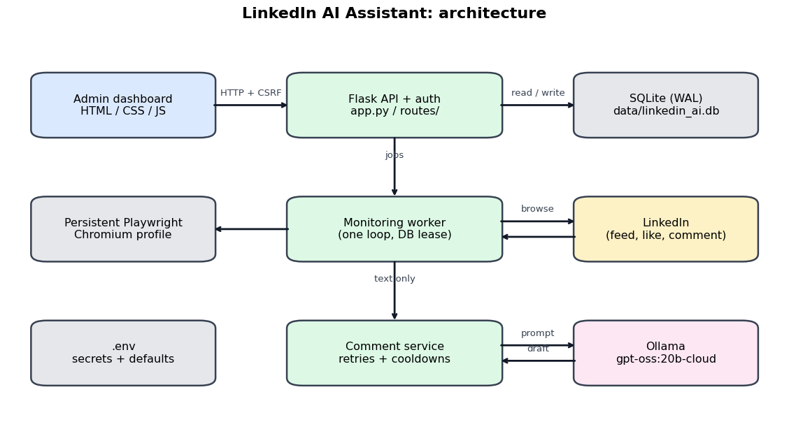
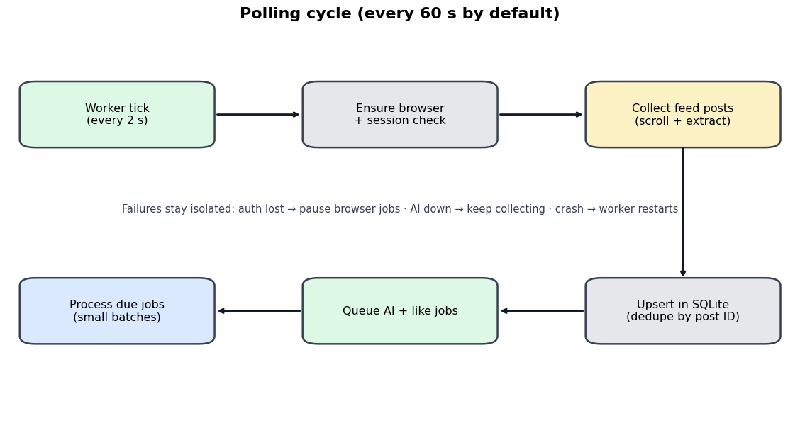
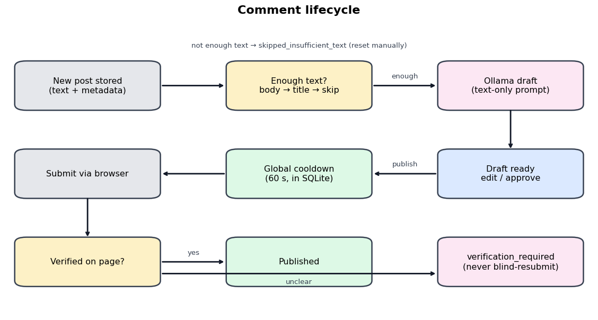

# LinkedIn Engagement Assistant

Local-first dashboard that monitors your LinkedIn feed with a persistent Playwright browser, drafts natural comments from the post text with an Ollama model (`gpt-oss:20b-cloud` by default), and manages liking and commenting through a responsive web page. Everything runs on your own machine and is stored in a single SQLite file.



## How it works
- **Monitoring:** one worker thread polls the feed every 60 seconds (configurable), scrolls, extracts text-only post data in a single page evaluation, and stores new posts. The first run looks back over the previous seven days. Posts are deduplicated by their stable post ID with the normalized URL as fallback.
- **AI drafts:** the model only ever receives text: body, title, accessible alt text, link descriptions and author name. Images and videos are never downloaded, stored or sent. Posts without enough meaningful text are marked `skipped_insufficient_text` and are not retried until you reset them.
- **Engagement:** liking and commenting are tracked independently, except that a post opened for a comment is liked first in the same visit (counted in the daily like limit). Comments follow the publishing mode, a global cooldown (default 60 s, persisted in SQLite) and a per-post retry cooldown.
- **Auto connect:** when enabled, the worker opens LinkedIn My Network (`/mynetwork/grow/`), clicks Connect on suggested people one by one with a pause between requests (`connect_gap`, default 10 s) and scrolls only when no Connect button is left in view. Capped per rolling 24 hours (`daily_connect_limit`, default 60).
- **Safeguards:** if LinkedIn shows the daily comment limit popup, commenting stops at once, a warning is logged and the Comments switch turns off until you resume it. Feed checking, likes, comments and connections each have their own pause/resume switch on the Dashboard, Posts and Queue pages.
- **Parallel lanes:** feed checking, likes, comments, connections and AI drafts each run in their own thread with their own job queue. The four browser lanes share one Chromium process and login profile, and each keeps its own connection and tab open and reuses it instead of reopening.
- **Reliability:** a persistent job queue in SQLite with exponential backoff, a worker supervisor that restarts after crashes, a database lease that prevents duplicate workers, and startup recovery of interrupted jobs.
- **Uncertain results:** if a comment submission cannot be confirmed, the post becomes `verification_required`. The next attempt first checks the post for the comment and never blindly resubmits.

| Polling cycle | Comment lifecycle |
|---|---|
|  |  |

## Built with
Python · [Flask](https://flask.palletsprojects.com) + [Waitress](https://docs.pylonsproject.org/projects/waitress) · [Playwright](https://playwright.dev/python) (Chromium) · SQLite · [Ollama](https://ollama.com) · vanilla HTML/CSS/JS.

## Publishing modes
| Mode | Likes | Comments |
|---|---|---|
| `manual` | Only when you click Like | Drafts wait for your approval and Publish |
| `mixed` (default) | Automatic when enabled | Drafts wait for your approval and Publish |
| `automatic` | Automatic when enabled | Published automatically when `auto_comment` is on |

Automatic likes are paced (`like_gap`, default 20 s) and limited to posts newer than `like_max_age_hours` (default 72). Likes and comments are also capped per rolling 24 hours (`daily_like_limit` default 120, `daily_comment_limit` default 60; 0 means no limit). All values are editable on the Settings page without a restart.

## Setup

### Windows 10/11
```
python -m venv .venv
.venv\Scripts\activate
pip install -r requirements.txt
playwright install chromium
copy .env.example .env
python scripts\init_db.py
python scripts\login.py
python app.py
```

### Linux
```
python3 -m venv .venv && source .venv/bin/activate
pip install -r requirements.txt
playwright install chromium
playwright install-deps chromium
cp .env.example .env
python scripts/init_db.py
python scripts/login.py
python app.py
```

### Android (Termux, experimental)
```
pkg update && pkg install python git
python -m venv .venv && source .venv/bin/activate
pip install -r requirements.txt
cp .env.example .env
```
Playwright does not ship a Chromium build for Termux. Install a system Chromium (for example from the `x11-repo` package set), then set `CHROMIUM_EXECUTABLE` and `BROWSER_NO_SANDBOX=true` as described in [Use your own Chromium](#use-your-own-chromium-chromium_executable). If the browser cannot start, the dashboard stays available and shows the exact error. Android may suspend background processes: use `termux-wake-lock`, disable battery optimisation for Termux, and expect interruptions. Continuous execution is not guaranteed. The session cannot be created on Android itself because there is no visible browser: log in on a desktop with `scripts/login.py`, then copy `data/browser_profile` to the same path on the device (this works most reliably between Linux machines).

### Configure `.env`
Set `ADMIN_PASSWORD` (10+ characters) and `SECRET_KEY` (32+ characters). Generate them with:
```
python -c "import secrets; print(secrets.token_urlsafe(18))"
python -c "import secrets; print(secrets.token_hex(32))"
```
The first command prints a value for `ADMIN_PASSWORD`, the second for `SECRET_KEY`. Paste them into `.env`:
```
ADMIN_PASSWORD=<first output>
SECRET_KEY=<second output>
```
Start Ollama and make the model available:
```
ollama signin
ollama pull gpt-oss:20b-cloud
```

### Use your own Chromium (`CHROMIUM_EXECUTABLE`)
This is optional. Leave `CHROMIUM_EXECUTABLE` empty to use the Chromium installed by `playwright install chromium`. Set it only when you want to use a browser that is already installed, which is required on Termux and some ARM devices.

1. Find the path of the browser.

Termux or Linux:
```
which chromium
which chromium-browser
which google-chrome
```

Windows (Command Prompt):
```
where chrome
```

2. Put the full path after the `=` in `.env`, with no quotes and no spaces around it. Expected paths:

| Platform | Expected path |
|---|---|
| Termux | `/data/data/com.termux/files/usr/bin/chromium-browser` |
| Linux | `/usr/bin/chromium` |
| Windows | `C:\Program Files\Google\Chrome\Application\chrome.exe` |

Termux:
```
CHROMIUM_EXECUTABLE=/data/data/com.termux/files/usr/bin/chromium-browser
BROWSER_NO_SANDBOX=true
```

Linux:
```
CHROMIUM_EXECUTABLE=/usr/bin/chromium
```

Windows:
```
CHROMIUM_EXECUTABLE=C:\Program Files\Google\Chrome\Application\chrome.exe
```

3. Restart the app. `.env` is read only at startup. If the path does not exist, the app refuses to start and prints `CHROMIUM_EXECUTABLE does not exist`.

The Termux package may be named `chromium` or `chromium-browser`, so use whatever `which` reports. These are the usual locations: if `which` or `where` prints a different path on your machine, use that one. `scripts/login.py` reads the same `.env` values, so run it again after changing them.

### First login
Option A (recommended): run `python scripts/login.py` before starting the app, sign in to the opened browser window, then press Enter in the terminal. The session is stored in `data/browser_profile`.

Option B: set `BROWSER_HEADLESS=false`, start the app, and sign in inside the visible window. The app detects the session automatically.

When the session expires the dashboard shows "Login required", browser actions pause, AI drafting and storage continue, and monitoring resumes by itself once you sign in again.

## Run and stop
- Start: `python app.py` and open `http://127.0.0.1:5000`.
- Stop: press `Ctrl+C` or send `SIGTERM`. The worker finishes the current job, saves state and closes the browser. Queued work is kept.
- Pause or resume monitoring from the dashboard. Pausing stops polling only; the queue is preserved.

### Keep it running on Linux (systemd)
```
[Unit]
Description=LinkedIn Engagement Assistant
After=network-online.target

[Service]
WorkingDirectory=/opt/linkedin-ai-assistant
ExecStart=/opt/linkedin-ai-assistant/.venv/bin/python app.py
Restart=always
RestartSec=10
User=linkedin

[Install]
WantedBy=multi-user.target
```

## Remote access
Keep `HOST=127.0.0.1` and put an encrypted layer in front. The admin password alone is not a substitute for encryption.
- **VPN (preferred):** run [Tailscale](https://tailscale.com) or WireGuard and open the dashboard through the VPN address. You can then bind `HOST` to the VPN interface address.
- **Reverse proxy with HTTPS:** for example Caddy:
```
assistant.example.com {
    reverse_proxy 127.0.0.1:5000
}
```
Then set `COOKIE_SECURE=true` and `TRUST_PROXY=true` in `.env`.

Login attempts are rate limited (5 failures per 15 minutes per address) and sessions expire after `SESSION_HOURS`.

## Database backup and restore
```
python scripts/backup_db.py
python scripts/backup_db.py --restore backups/linkedin_ai_YYYYMMDD_HHMMSS.db
```
Stop the app before restoring. The current database is saved to `backups/` before it is replaced.

## Troubleshooting
| Symptom | Fix |
|---|---|
| "Chromium is not installed" | `playwright install chromium`, or set `CHROMIUM_EXECUTABLE` to an installed browser |
| "CHROMIUM_EXECUTABLE does not exist" | Check the path with `which` / `where`, with no quotes or extra spaces, then restart |
| "Missing system libraries" | `playwright install-deps chromium` (Linux) |
| "Browser profile is locked" | Close other Chromium windows using `data/browser_profile`, or stop the second instance |
| Port already in use | Change `PORT` in `.env`; Windows: `netstat -ano \| findstr :5000` |
| "Login required" | Run `python scripts/login.py` with the app stopped, or use `BROWSER_HEADLESS=false` |
| AI shows `down` or `model_missing` | Start `ollama serve`, run `ollama signin` and `ollama pull gpt-oss:20b-cloud` |
| Posts found but no text | LinkedIn changed its page structure: update the selectors at the top of `services/linkedin_browser.py` and the script in `services/post_collector.py` |
| "Another process holds the lease" | Another instance is running; stop it or wait about 90 seconds after a crash |

Logs are in `logs/app.log` (rotating) and on the Logs page. Secrets are redacted. Use **Clear logs** on the Logs page to delete the entries and empty the log files.

## Project structure
```
app.py                       Flask app factory, security headers, server entry point
config.py                    .env loading and runtime setting validation
database/                    SQLite connection, migrations, data access
services/linkedin_browser.py Shared Chromium host, per-lane Playwright connections, like, comment and connect actions
services/post_collector.py   Feed discovery and text-only extraction
services/text_extractor.py   Text cleaning, URL normalisation, AI context rules
services/ollama_service.py   Ollama client and health check
services/comment_service.py  Prompting, validation and draft storage
services/engagement_service.py Like and comment execution, cooldowns, manual actions
services/retry_service.py    Backoff, failure marking, restart recovery
services/monitoring_worker.py Supervisor and parallel lanes: feed, like, comment, connect, AI
services/health_service.py   Runtime status and health checks
routes/                      Auth, pages and JSON API
templates/ static/           Dashboard UI
scripts/                     init_db, backup_db, login
```

## Contributing
Read [CONTRIBUTING.md](CONTRIBUTING.md) for the code map and workflow. Issues and PRs are welcome.

## License and credit
[MIT](LICENSE). You may use, modify and sell this freely, but you must keep the copyright notice. If you build on this project, please credit **[Amaan (@Amaan9136)](https://github.com/Amaan9136)**, for example: *"Based on LinkedIn Engagement Assistant by Amaan9136"* in your README, About page or docs.